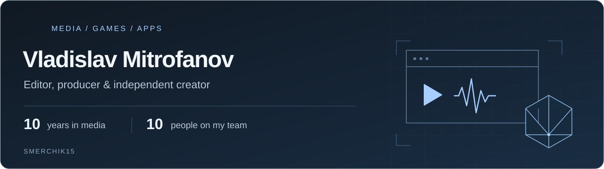

<a href="./README.md">Русский</a> · <strong>English</strong>

**I make games and apps for the things I enjoy. Built with AI, refined through use.**

[Website & projects ↗](https://smerchik15.github.io/) · [Get in touch](mailto:vladislavmitro@gmail.com)

### Media work

Editor and producer with **10 years of experience** across video platforms and social media. I lead a **team of 10**.

I work on YouTube, RUTUBE and social media at **Moscow 24**, including **Omar in the Big City** and **Moslektoriy**. My work covers content, titles and thumbnails, analytics, and team management.

### Personal projects

#### КЛЕЩ · Blood Gains
A browser auto-shooter with mutations, bosses and character progression. Play on desktop or mobile.  
[Play ↗](https://tick-wild-fur-v2.vladislavmitro.chatgpt.site/) · [Source code](https://github.com/smerchik15/tick-blood-gains)

#### Reikland Character Forge
Tools for tabletop role-playing games: WFRP 4e character creation, character sheets and adventure preparation.  
[Create a character ↗](https://reikland-character-forge.noblebell32.chatgpt.site/)

#### Голос · Voice
A personal voice practice studio: exercises, recording and comparing takes, and annotating scripts before reading.  
[Open the studio ↗](https://voice-studio-vladi.noblebell32.chatgpt.site/)

#### Мастерская · Workshop
A space for creative projects: ideas, notes, discussions and task planning, on your own or with a team.  
[Open Workshop ↗](https://masterskaya-ideas.vladislavmitro.chatgpt.site/)

---

**Have a project in mind?** Get in touch about video and social content, titles and thumbnails, analytics, or working prototypes built with AI.

[vladislavmitro@gmail.com](mailto:vladislavmitro@gmail.com) · [smerchik15.github.io](https://smerchik15.github.io/)
