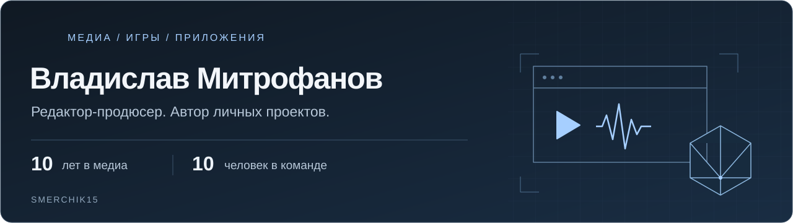

<strong>Русский</strong> · <a href="./README.en.md">English</a>

**Делаю игры и приложения для того, чем увлечён. Собираю с помощью ИИ, развиваю на практике.**

[Сайт и проекты ↗](https://smerchik15.github.io/) · [Написать мне](mailto:vladislavmitro@gmail.com)

### В медиа

Редактор-продюсер с **10-летним опытом** работы с видеоплатформами и соцсетями. В моей команде — **10 человек**.

Работаю с YouTube, RUTUBE и соцсетями «Москвы 24», в том числе с проектами **«Омар в большом городе»** и **«Мослекторий»**. Занимаюсь контентом, упаковкой, аналитикой и организацией работы команды.

### Личные проекты

#### КЛЕЩ · Blood Gains
Браузерный автошутер: мутации, боссы и развитие героя. Для компьютера и телефона.  
[Играть ↗](https://tick-wild-fur-v2.vladislavmitro.chatgpt.site/) · [Исходники](https://github.com/smerchik15/tick-blood-gains)

#### Reikland Character Forge
Инструменты для настольных ролевых игр: создание персонажей WFRP 4e, листы героев и подготовка к приключениям.  
[Создать персонажа ↗](https://reikland-character-forge.noblebell32.chatgpt.site/)

#### Голос
Личная студия для практики речи: упражнения, запись и сравнение дублей, разметка текста перед чтением.  
[Открыть студию ↗](https://voice-studio-vladi.noblebell32.chatgpt.site/)

#### Мастерская
Пространство для творческих проектов: идеи, заметки, обсуждения и план работы — самостоятельно или с командой.  
[Открыть Мастерскую ↗](https://masterskaya-ideas.vladislavmitro.chatgpt.site/)

---

**Обсудим задачу?** Контент для видеоплатформ и соцсетей, упаковка проектов, аналитика и рабочие прототипы с ИИ.

[vladislavmitro@gmail.com](mailto:vladislavmitro@gmail.com) · [smerchik15.github.io](https://smerchik15.github.io/)
